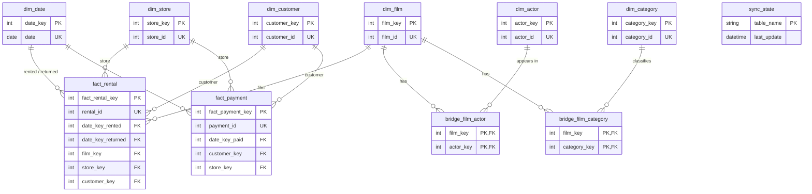

# Sakila ORM Sync

Databases — Assignment 4 · Eric von Uhlendorff (`ericvu`)

A Python pipeline that syncs the MySQL Sakila database to a SQLite analytics schema using SQLAlchemy. It supports full loads, incremental updates, and consistency checks.

## Stack

- Python 3.12, SQLAlchemy 2.1.8, PyMySQL 1.2.4, and pytest 9.2.0.
- Source: MySQL 8.0 in Docker. Target: SQLite through Python.

## Setup

With Python 3.12 and Docker Compose available, run from the repository root:

```bash
python3.12 -m venv .venv
source .venv/bin/activate
pip install -r requirements.txt
cp .env.example .env
```

Set `MYSQL_PASSWORD` in `.env` and adjust `MYSQL_PORT` if needed. Then start MySQL:

```bash
docker compose up -d
```

Docker Compose mounts the SQL scripts in `docker/initdb/` at `/docker-entrypoint-initdb.d` inside the container. When the `mysql_data` volume is empty, MySQL runs these scripts automatically to create and populate `sakila` and `sakila_test`. Wait for initialization to finish before running the pipeline.

Python connects using the `MYSQL_*` values in `.env`: `MYSQL_HOST` and `MYSQL_PORT` locate the server, while `MYSQL_DATABASE=sakila` selects the source database. No manual SQL import is needed.

To rebuild MySQL from scratch, deleting its stored data:

```bash
docker compose down -v
docker compose up -d
```

## Environment Variables

Configure these values in `.env`:

| Variable | Value or purpose |
| --- | --- |
| `MYSQL_HOST` | `127.0.0.1` |
| `MYSQL_PORT` | `3307`, or another available host port |
| `MYSQL_USER` | `root` |
| `MYSQL_PASSWORD` | Your MySQL password |
| `MYSQL_DATABASE` | `sakila` |
| `MYSQL_TEST_DATABASE` | `sakila_test` |
| `SQLITE_PATH` | SQLite output file; `analytics.db` in `.env.example` |

## Running the Pipeline

Run the commands in this order, then repeat `incremental` for later changes:

```bash
python -m sync.cli init
python -m sync.cli full-load
python -m sync.cli incremental
```

| Command | Purpose |
| --- | --- |
| `init` | Creates the analytics tables and fills `dim_date` and `sync_state`. |
| `full-load` | Loads all source data; safe to rerun without creating duplicates. |
| `incremental` | Loads new and updated rows based on the last sync markers. |
| `validate` | Compares MySQL and SQLite for consistency. |

Validation defaults to the 30 days ending on the latest payment date. Use `--from` and `--to` to choose a period:

```bash
python -m sync.cli validate
python -m sync.cli validate --from 2005-07-01 --to 2005-07-31
```

Commands report success or failure and exit with `0` or `1`. Both `full-load` and `incremental` validate before committing; a mismatch rolls back the load.

## Tests

With MySQL running and `.env` configured:

```bash
pytest -v
```

Each test resets `sakila_test` from `sakila` and uses a temporary SQLite file. Tests read from `sakila` but do not modify it. Keep the main and test database names different.

## ER Diagram

The diagram shows the SQLite tables and their keys. `PK` is a primary key, `FK` a foreign key, and `UK` a unique key; each relationship is one-to-many.



`dim_date` serves both rental and return dates; `date_key_returned` is nullable until a rental is returned. `sync_state` stores one timestamp marker per source table and has no foreign keys.

## Indexes

| Columns | Purpose |
| --- | --- |
| Unique natural keys: `film_id`, `actor_id`, `category_id`, `store_id`, `customer_id`, `rental_id`, `payment_id` | Prevent duplicates on reruns and speed up lookups. |
| Unique `dim_date.date` | Keeps one row per calendar day. |
| `fact_rental`: `date_key_rented`, `date_key_returned`, `film_key`, `store_key`, `customer_key` | Support dimension joins and date filters. |
| `fact_payment`: `date_key_paid`, `customer_key`, `store_key` | Support dimension joins and date filters. |
| `bridge_film_actor.actor_key`, `bridge_film_category.category_key` | Support lookups by actor or category; the composite primary keys cover lookups by film. |

## Raw SQL Usage

The pipeline uses SQLAlchemy, with raw SQL in two places:

- `validation/tests/conftest.py`: `DROP TRIGGER`, `SET FOREIGN_KEY_CHECKS`, `TRUNCATE`, and `INSERT ... SELECT` reset `sakila_test`. These statements are limited to test setup; I did not find an ORM alternative for this reset workflow.
- `connection/db.py`: `PRAGMA foreign_keys=ON` enables SQLite foreign key enforcement on each connection, since SQLite does not enable it by default.
